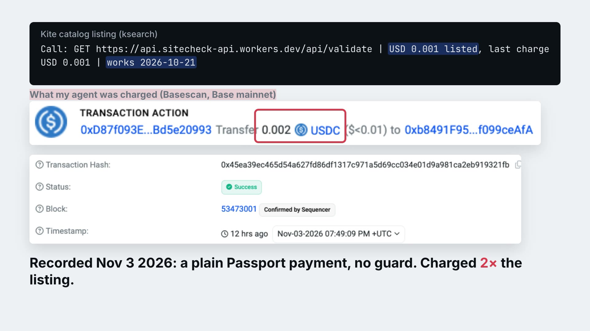

# Signoff

**Check what your agent is about to pay for before Passport pays.**

A Kite Passport session caps *how much* an agent can spend. It doesn't check what the agent is actually being charged, who receives the money, or whether the call serves what you asked for. Signoff runs those checks before every payment.

Built for SERV Hackathon 02, Kite track. It uses SERV Reasoning for intent checks and Kite Passport for payments.

## Demo (1:25)

[](https://youtu.be/9GDkkxlrAGA)

[Watch the demo on YouTube](https://youtu.be/9GDkkxlrAGA), or download the [MP4](media/signoff-demo.mp4) (11 MB). It shows a real 2× charge that plain Passport paid on Nov 3, then a live run on Nov 4: the same call refused, an off-intent request refused by SERV, and a clean paid call with its receipt. Every terminal line in the video is real output, with cuts marked `⋯`.

## For reviewers: each claim, its code and how to check it

| Claim | Code | Check |
|---|---|---|
| Refuse and hold rules (price drift, over budget, payee change, retired, wrong asset, off-intent) | `decide()` in [`src/guard.ts`](src/guard.ts) | `npm test` (12 tests, no credentials) |
| A SERV verdict must quote the request or reply verbatim, or it becomes `unsure` and the payment is held | `validateFit()` and `servFit()` in [`src/guard.ts`](src/guard.ts) | [`test/guard.test.ts`](test/guard.test.ts) |
| Pays only on `ALLOW`, through `kpass session execute` | `pay()` in [`src/guard.ts`](src/guard.ts); the `pay` command in [`scripts/guard.ts`](scripts/guard.ts) | Receipts with Base transactions in [`evidence/`](evidence/README.md) |
| 24 of 165 `works` endpoints asked more than listed | `report()` in [`src/guard.ts`](src/guard.ts) | [`evidence/drift-report-*.json`](evidence/); rerun free with `npm run guard -- report` (live numbers will move as the catalog changes) |
| Plain Passport paid 2× silently; the guard's paid calls | n/a | Basescan links in [`evidence/README.md`](evidence/README.md) |

`npm ci && npm test && npm run typecheck` needs no credentials. `check` and `report` also need Kite's CLI, but no wallet. Intent checks need `SERV_API_KEY`; without it they `HOLD`.

## The problem, measured on Kite's own catalog

Kite's discovery catalog lists each paid endpoint with a price and a state (`works`, `untested` or `broken`). Agents plan with those listed prices. The payment itself is whatever the endpoint's live `402 Payment Required` asks for, and Passport pays it as long as it fits under the session cap.

On 2026-11-03 and again on 2026-11-04, we sent unpaid requests to a 343-endpoint keyword sample of the catalog and compared each live payment request with its listing:

- **24 of 165 endpoints marked `works` asked more than their listed price**, mostly 2× and up to 10× (app.tenna.ai: $0.10 against a listed $0.01).
- Endpoints marked `untested` asked up to **$10 against a listed $0.022** (stablestudio, 455×) and **$2 against $0.005** (stableupload, 400×). Both use the fixed `exact` payment scheme.
- One endpoint marked `works` answered `410 Gone` ("retired").
- **Plain Passport paid a 2× charge silently.** Two sitecheck endpoints listed at $0.001 charged $0.002 each, with no warning:
  - [`0x45ea39ec…21fb`](https://basescan.org/tx/0x45ea39ec465d54a627fd86df1317c971a5d69cc034e01d9a981ca2eb919321fb)
  - [`0xa19a865d…35a8`](https://basescan.org/tx/0xa19a865dff80bccb65f12747c1b7a4718c5944b6b8b20925c0604cb5729835a8)
- The catalog records no expected payee, so Passport pays whatever `payTo` address the live 402 names.

These are small amounts today. The point is structural: nothing between the listing and the signature compares them.

Reproduce it yourself for free; no wallet is needed. You need Node 24 and Kite's CLI, which installs `kpass` and `ksearch`:

```sh
curl -fsSL https://cli.gokite.ai/install.sh | bash
git clone https://github.com/fexx301/signoff && cd signoff
npm ci
npm run guard -- report
```

## What Signoff checks

`check` sends the request unpaid and reads the payment terms. `pay` runs the same check and pays through your Passport session only if the decision is `ALLOW`.

| Check | Decision | Why |
|---|---|---|
| Live price above the listed price (beyond `--slippage-bps`) | `REFUSE price_drift` | You planned for the listing, not the live price |
| Live price above `--max-usd` | `REFUSE over_budget` | Your per-call limit |
| `payTo` differs from the payee pinned on first successful use | `REFUSE payee_changed` | Trust on first use, like SSH `known_hosts`. Shown live with a hand-edited pin in `evidence/` |
| Endpoint answers `410 Gone` | `REFUSE retired` | |
| No USDC-on-Base option | `REFUSE wrong_asset` | |
| SERV: this endpoint or this exact request doesn't serve the intent | `REFUSE off_intent` | Arithmetic can't tell a translation API from a sentiment API |
| SERV unsure, or SERV unavailable | `HOLD intent_unclear` | Fails closed |
| Unpaid `404` or `5xx`, variable-price scheme, or unlisted price | `HOLD` | Not proof of a problem; a person decides |

Every decision writes a receipt to `.signoff/receipts/` with:
- the listing and its hash;
- the live terms;
- the reasons for the decision;
- the SERV verdicts and the quotes they rest on;
- if paid, the Base transaction and a hash of the reply.

After a payment, SERV also checks whether the reply satisfies the intent. That verdict is recorded on the receipt.

## How SERV is used

SERV Reasoning makes the two judgements the arithmetic can't:

1. **Before paying:** does this endpoint, called with this exact request, serve the user's intent?
2. **After paying:** does the reply satisfy it?

Both calls use a strict JSON schema with three verdicts: `yes`, `no` or `unsure`. A `yes` or `no` must quote an exact substring of the request or reply. Otherwise Signoff downgrades it to `unsure` and holds the payment.

Live examples from 2026-11-04 (`gpt-5.4-mini` via SERV):

| Intent | Request | Result |
|---|---|---|
| "Convert the hex value ff to decimal" | base-convert, `from:16, to:10` | ALLOW. Paid [`0x210b1a2f…f2b7`](https://basescan.org/tx/0x210b1a2f23e6f9859685d9d7018f22f425c327fbabfb270283b7a8308de4f2b7); the reply check confirmed "255" |
| same | base-convert, `to:2` | REFUSE off_intent, quoting `"to":2` |
| "Is this review positive or negative?" | a translation endpoint | REFUSE off_intent: wrong job |
| "Weather in Lagos this week" | weather at `lat=52.52&lon=13.405` (Berlin) | REFUSE off_intent, quoting the coordinates |

## How Kite Passport is used

- **Payments:** `pay` calls `kpass session execute` in a passkey-approved Passport session, which enforces the per-call and total caps. Signoff decides whether that call should happen at all.
- **Endpoint data:** listings, prices and catalog states come from Kite's discovery catalog through `ksearch`.

## Quick start

Requirements: Node 24, plus Kite's CLI: `curl -fsSL https://cli.gokite.ai/install.sh | bash` installs `kpass` and `ksearch`.

```sh
npm ci
cp .env.example .env.local      # set SERV_API_KEY for intent checks

# Free: compare one endpoint's live terms with its listing
npm run guard -- check 064eadae0eb4a78c7864f5f3 --body '{"value":"ff","from":16,"to":10}' \
  --intent "Convert the hex value ff to decimal"

# Pays only on ALLOW. PASSPORT_DIR is the folder holding your Passport login
# and an approved session (kpass session create ...); it defaults to the current folder.
PASSPORT_DIR=~/my-passport npm run guard -- pay 064eadae0eb4a78c7864f5f3 \
  --body '{"value":"ff","from":16,"to":10}' --intent "Convert the hex value ff to decimal"

# Free catalog-wide drift report
npm run guard -- report
```

Options:
- `--max-usd` sets the per-call limit (default 0.02).
- `--slippage-bps` sets the allowed price drift above the listing (default 0).
- `--query` and `--body` override the listing's example input.

Exit codes: `0` allowed or paid, `2` refused, `3` held, `1` error.

## Use it from your agent

[`skills/signoff-guard/SKILL.md`](skills/signoff-guard/SKILL.md) is a drop-in skill for agents that pay with Kite Passport. It tells the agent to run Signoff's `pay` instead of calling `kpass session execute` directly, to pass the user's own words as the intent, and how to act on each decision: report an ALLOW, explain a REFUSE and never route around it, and ask the user on a HOLD. Run from any folder, Signoff uses that folder's Passport login:

```sh
PASSPORT_DIR="$PWD" npm --prefix ~/signoff run -s guard -- pay <catalogId> --intent "<the user's request>"
```

## Revenue (a plan, not yet tested with customers)

- **Hosted guard, priced per check.** Run Signoff as a paid x402 endpoint in Kite's catalog, so agents pay a fraction of a cent per check through Passport, the same rail it protects. Price, payee and liveness checks cost one unpaid HTTP request to run; the paid tier covers SERV's intent and reply checks.
- **Catalog health feed.** A scheduled drift and liveness feed for catalogs and marketplaces, Kite's included, to replace `untested` states and stale prices. It is cheap to produce: the 343-endpoint sweep takes about 50 seconds and pays nothing.
- **Verified listings.** Sellers pay for scheduled re-checks that keep their listing's price, payee and liveness verified.

No customer has been asked yet. What is established is that the problem exists on Kite's live catalog today.

## Evidence in this repo

`evidence/` holds two 2026-11-04 drift reports and the guard's receipts, with an index in [`evidence/README.md`](evidence/README.md): three paid ALLOW calls with Base transactions, the refusals (price drift, over budget, retired, off-intent, and a payee change shown with a hand-edited pin), and the two silent 2× charges from before the guard. Raw catalog data comes from Kite's public discovery service, and transactions can be checked on Basescan.

The findings were sent to Kite through Passport's agent feedback channel on 2026-11-04.

`scripts/audit-probe.ts` and `scripts/free-audit.py` are the research scripts behind the first measurements. `scripts/arbiter-probe.ts` records a probe of Kite's agreement runtime. On dev it answered that the agreement surface is not yet live.

## Limits

- **Small samples.** The catalog numbers come from a keyword sample (343 endpoints), checked once per run. Prices can change legitimately; the finding is that listings go stale, not that any seller misbehaved.
- **Re-fetch window.** `kpass` re-fetches the 402 just before signing. If the price moves between Signoff's check and the payment, the receipt flags it (`paidDiffersFromChecked`) but cannot prevent it. Closing that window needs Passport to accept a pinned amount and payee.
- **Payee pins are stored locally** in `.signoff/pins.json`. A first use is trusted by definition. No real payee change has been observed; the refusal is shown with a hand-edited pin.
- **Limited SERV evidence.** The intent checks are LLM judgements bound to quoted evidence. They hold when unsure, but they are not proven against adversarial inputs.
- **Paid checks are narrow.** Twenty paid audit calls found no endpoint that returned wrong output for its listing, so Signoff does not claim sellers deliver bad work.

## Repository history

The first commits are an earlier prototype: a custodial acceptance-escrow processor. It was shelved because Passport could not pay a custom host and Kite runs its own escrow runtime. It has been removed from `main` so this branch holds only the guard. The full prototype, with passing tests, lives on the [`escrow-prototype`](https://github.com/fexx301/signoff/tree/escrow-prototype) branch (tag `escrow-prototype-v0`). Its tests include deliberately malicious prompt-injection fixtures, each labelled as adversarial test input.

## License

MIT. See [LICENSE](LICENSE).
